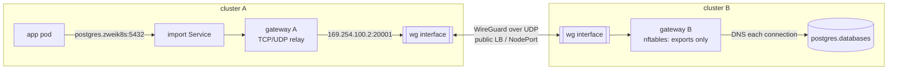

<p align="center"></p>

<h1 align="center">zweik8s</h1>

<p align="center"><b>Use a Service in another Kubernetes cluster as if it were local.</b><br>
One WireGuard tunnel, one small gateway per cluster, no mesh, no CNI changes.</p>

<p align="center">
<a href="https://github.com/abexamir/zweik8s/actions/workflows/ci.yaml"></a>
<a href="https://github.com/abexamir/zweik8s/releases"></a>
<a href="LICENSE"></a>
</p>

```text
cluster A                                                   cluster B
┌─────────────────────────────┐                ┌──────────────────────────────┐
│ app ──► Service "postgres"  │                │                              │
│            │                │   WireGuard    │                              │
│      zweik8s gateway ═══════╪══ UDP, one ════╪═══ zweik8s gateway           │
│                             │     port       │            │                 │
│                             │                │            ▼                 │
│                             │                │  postgres.databases.svc      │
└─────────────────────────────┘                └──────────────────────────────┘
```

Cluster B **exports** `postgres.databases`; cluster A **imports** it. Apps in A connect to an
ordinary ClusterIP Service. The gateway relays each connection through the tunnel, and B's
gateway opens a fresh connection to the real Service, resolving its DNS name every time.

## Why

- **Nothing to change in your clusters.** It runs in an ordinary pod network namespace: no host
  routes, no CNI or kube-proxy settings, no overlapping-CIDR problems, no control plane.
- **Explicit and narrow.** Only declared Services cross, only to declared ports, and only pods
  you label may call an import (NetworkPolicy). A compromised peer cannot reach anything else:
  each gateway drops every packet from the tunnel that is not for an export.
- **Survives NAT and restarts.** The gateway pins the encrypted traffic to the peer's public
  endpoint and probes the peer through the tunnel. If the peer goes silent, it opens a new
  source port and re-handshakes, so stale NAT mappings heal by themselves.
- **Fast.** A multi-threaded Rust data path: splice(2) for TCP (payload never enters user space),
  recvmmsg/sendmmsg batches for the encrypted UDP, BBR on the tunnel leg. About 1.5 Gbit/s on
  two cores; between two real data centers it beats a direct LoadBalancer path on single
  streams (see [benchmarks](docs/benchmarks.md)).
- **Observable.** `/metrics` for Prometheus, `zweik8s status` for humans, JSON logs.

## Quick start

You need two clusters that can reach each other over UDP: each publishes one UDP port, through
a LoadBalancer or a NodePort.

**1. Keys.** One WireGuard key pair per side:

```sh
wg genkey | tee a.key | wg pubkey > a.pub
wg genkey | tee b.key | wg pubkey > b.pub
```

**2. A namespace and a key Secret on each side.** The gateway needs `NET_ADMIN`, so its namespace
must allow privileged pods. Keep the namespace for zweik8s alone.

```sh
# cluster A
kubectl create namespace zweik8s
kubectl label namespace zweik8s pod-security.kubernetes.io/enforce=privileged
kubectl -n zweik8s create secret generic zweik8s-keys --from-file=private-key=a.key --from-file=peer-public-key=b.pub
# cluster B: the same with b.key and a.pub
```

Prefer [External Secrets](docs/configuration.md#keys) in production.

**3. Install on both sides.** Each side names the other's public endpoint:

```yaml
# a.yaml                                   # b.yaml
tunnel: {address: 169.254.100.1}           tunnel: {address: 169.254.100.2}
peer:                                      peer:
  address: 169.254.100.2                     address: 169.254.100.1
  endpoint: <B's public IP>:31822            endpoint: <A's public IP>:31821
keys: {existingSecret: zweik8s-keys}       keys: {existingSecret: zweik8s-keys}
service: {nodePort: 31821}                 service: {nodePort: 31822}
imports:                                   exports:
  - name: postgres                           - name: postgres
    ports:                                     service: postgres
      - {port: 5432, tunnelPort: 20001}        namespace: databases
    callers:                                   ports:
      - namespace: "*"                           - {port: 5432, tunnelPort: 20001}
        matchLabels: {zweik8s.io/access: "true"}
```

```sh
helm install zweik8s oci://ghcr.io/abexamir/charts/zweik8s -n zweik8s -f a.yaml   # cluster A
helm install zweik8s oci://ghcr.io/abexamir/charts/zweik8s -n zweik8s -f b.yaml   # cluster B
```

**4. Use it.** Label the calling pods with `zweik8s.io/access: "true"` and connect to
`postgres.zweik8s.svc.cluster.local:5432`. TLS and authentication pass through untouched.

```sh
kubectl -n zweik8s exec deploy/zweik8s -- zweik8s status
```

## How it works



Each gateway owns a kernel WireGuard interface inside its pod and a `/32` tunnel address. Imports
listen on the pod IP and relay to the peer's tunnel address. Exports listen only on the tunnel
address and connect to the local target. Details: [architecture](docs/architecture.md).

## Documentation

- [Architecture](docs/architecture.md): data path, NAT handling, recovery, design choices
- [Configuration](docs/configuration.md): every value, keys, exposure options, tuning
- [Security](docs/security.md): trust boundaries and what is enforced where
- [Operations](docs/operations.md): status, metrics, alerts, key rotation, troubleshooting
- [Benchmarks](docs/benchmarks.md): numbers and how to reproduce them

## Limits

- Two clusters per tunnel; run one release per pair for more.
- One gateway per cluster: replacing the pod drops open connections (clients reconnect). There
  is no seamless failover.
- The target sees the gateway as the client, not the original pod. Authenticate at the
  application layer, as you would anyway.
- IPv4 tunnel addresses and peer endpoints.

## Development

```sh
cargo test                      # unit tests
sudo tests/e2e/run.sh           # two network namespaces, real WireGuard (Linux, root)
tests/chart/run.sh              # chart rendering and validation
```

Licensed under [Apache-2.0](LICENSE).
